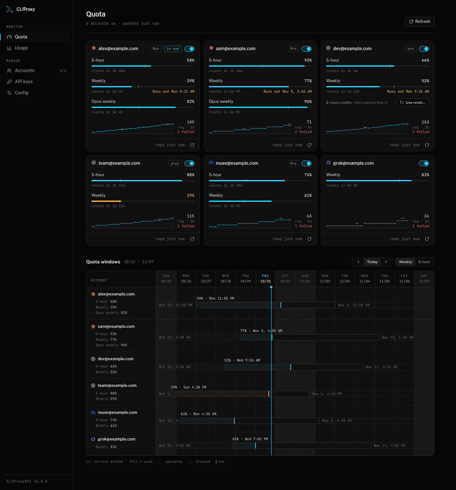
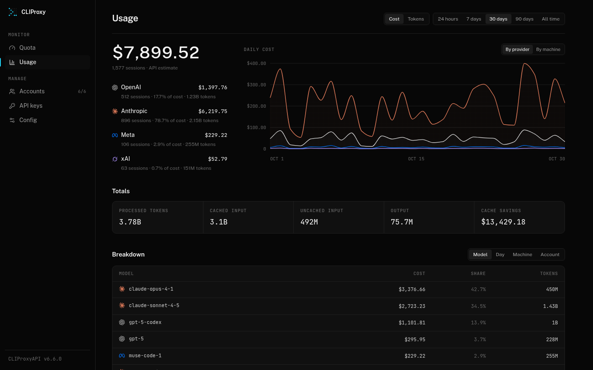
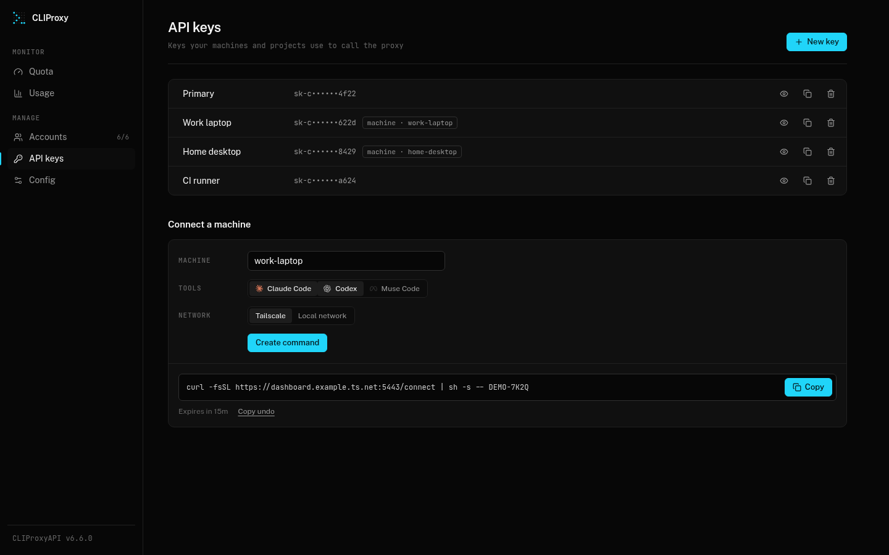

# cliproxy-dashboard

A web UI for [CLIProxyAPI](https://github.com/router-for-me/CLIProxyAPI)'s management API: an alternative to the built-in management panel, plus a usage history that the proxy itself does not keep.



## What it does

| Page     | What you get |
| -------- | ------------ |
| Quota    | Claude and Codex account quota windows (5-hour and weekly) on a timeline, with pace against the reset |
| Usage    | Cost and tokens by provider, model, machine, client key and day, priced from LiteLLM's public price table |
| Accounts | Add Claude and Codex accounts through OAuth, enable, disable, or remove them |
| API keys | Create, label and revoke client keys; optional one-command setup of Claude Code / Codex on another machine |
| Config   | Edit `config.yaml` as a form or YAML, review a diff before saving; every save snapshots the previous file |





It is one Bun process: a Hono server that serves the built React app, bridges `/v0/management/*` to the proxy, and collects the proxy's usage records into SQLite.

## Requirements

- CLIProxyAPI **v7.1.18 or later** (first release with usage Pub/Sub). Tested against v8.0.36.
- Remote management enabled on the proxy with a `secret-key`.
- Usage statistics enabled on the proxy (see below).
- [Bun](https://bun.sh) 1.4+ and Node 22.12+ (for the build), or Docker.

## Quick start

On the machine running CLIProxyAPI:

1. Enable usage records in the proxy's `config.yaml` and restart or let it hot-reload:

   ```yaml
   observability:
     usage:
       usage-statistics-enabled: true
       redis-usage-queue-retention-seconds: 3600
   ```

   On pre-v8 configs the same keys sit at the top level.

2. Clone, configure, build and run:

   ```sh
   git clone https://github.com/JarenKempton/cliproxy-dashboard.git
   cd cliproxy-dashboard
   cp .env.example .env.local      # set CPA_MANAGEMENT_KEY, and CPA_TARGET if the proxy isn't on 127.0.0.1:8317
   npm ci
   npm run build
   bun server/src/index.ts
   ```

3. Open <http://127.0.0.1:5174>.

The server logs `[collector] subscribed to CLIProxyAPI usage` once it is receiving records. `/api/health` shows the same.

## Configuration

All configuration is environment variables, read from `.env.local` in the working directory (Bun loads it automatically) or the process environment. See [`.env.example`](.env.example).

| Variable | Default | Purpose |
| -------- | ------- | ------- |
| `CPA_MANAGEMENT_KEY` | required | Plaintext management key (the `remote-management.secret-key` you log in to the built-in panel with) |
| `CPA_TARGET` | `http://127.0.0.1:8317` | CLIProxyAPI base URL; the usage collector connects to the same host and port |
| `CPA_ALLOW_WRITES` | unset | `1` forwards every management write, not only the dashboard's own |
| `USAGE_SERVER_HOST` | `127.0.0.1` | Dashboard listen address |
| `USAGE_SERVER_PORT` | `5174` | Dashboard listen port |
| `LAN_PORT` | `0` (off) | Local-network listener for connecting other machines and importing their history; binds `0.0.0.0` |
| `TAILSCALE_BIN` | auto | Path to the `tailscale` CLI, used to name machines by their tailnet name |
| `TAILNET_DASHBOARD_PORT` | `5443` | Port `tailscale serve` exposes the dashboard on, for connect commands |
| `TAILNET_DASHBOARD_URL` | derived | Dashboard URL handed to tailnet machines, when it differs from the derived one |
| `TAILNET_PROXY_URL` | derived | Proxy URL handed to tailnet machines, when it differs from the derived one |
| `USAGE_DB_PATH` | `data/usage.db` | SQLite database |
| `PRICE_CACHE_PATH` | `data/litellm-prices.json` | Cached LiteLLM price table |
| `DASHBOARD_DIST` | `dist` | Built frontend to serve |

## Deploy

### Bun, as a service

Run `bun server/src/index.ts` from the repo directory under systemd, launchd, or similar. Keep `data/` and `.backups/` on persistent storage.

### Docker

```sh
docker build -t cliproxy-dashboard .
docker run -d --name cliproxy-dashboard --restart unless-stopped \
  --network host \
  --env-file .env.local \
  -v "$PWD/data:/app/data" \
  -v "$PWD/.backups:/app/.backups" \
  cliproxy-dashboard
```

Host networking keeps the default `127.0.0.1` binding meaningful and lets the container reach a proxy on the host's loopback. It is Linux-only; elsewhere, publish the port to loopback (`-p 127.0.0.1:5174:5174`), set `USAGE_SERVER_HOST=0.0.0.0` inside the container, and point `CPA_TARGET` at an address the container can reach.

### Tailscale

[`deploy/compose.yaml`](deploy/compose.yaml) runs the dashboard next to a Tailscale sidecar that serves it over HTTPS on your tailnet ([`deploy/serve.json`](deploy/serve.json)). It expects `DATA` to point at a directory holding `env`, `ts-authkey` and `serve.json`, and runs the image named by `IMAGE` (build your own with `docker build`). [`deploy/hook.ts`](deploy/hook.ts) is an optional signed webhook for redeploying a TrueNAS app from CI (`image.yml` calls it only when the `DEPLOY_HOOK_URL` repository variable is set).

## Security

- **The dashboard has no login.** Anyone who can reach it can do what the management key allows. It binds to `127.0.0.1` by default; to reach it from elsewhere, use an SSH tunnel, `tailscale serve`, or a reverse proxy with its own authentication. Do not expose it directly to a network.
- The management key stays server-side. The bridge injects it into requests to the proxy; it is never sent to the browser.
- Writes are allowlisted to the dashboard's own actions unless `CPA_ALLOW_WRITES=1`. GETs with side effects (draining `/usage-queue`, provider auth URLs other than Claude and Codex) are blocked.
- After a single `401` from the proxy, the bridge stops forwarding until restart, because CLIProxyAPI bans an IP for about 30 minutes after 5 failed key attempts.
- Every config write first snapshots `config.yaml` into `.backups/` (last 50, mode `600`). Those snapshots contain your proxy's secrets; treat the directory accordingly.
- `LAN_PORT` opens a listener on all interfaces. It serves only the connect scripts, one-time connect codes, and a history import that requires a valid proxy API key. Leave it at `0` unless you need it.

## Limitations

- **Single consumer of usage records.** CLIProxyAPI deletes a usage record once it is read, so the dashboard must be the only thing reading the usage queue. Records produced while the dashboard is down are kept for at most `redis-usage-queue-retention-seconds` (max 3600).
- Costs are estimates from public API list prices, not what any account is billed. Models missing from LiteLLM's table show as unpriced.
- Quota windows are shown for Claude and Codex OAuth accounts only. Other providers appear on the Accounts page without quota.
- In-browser account login supports Claude and Codex only; add other providers through CLIProxyAPI directly.
- Connecting another machine from the API keys page needs Tailscale or `LAN_PORT`; with neither, the button stays disabled.
- No multi-user support or roles.

## Development

```sh
npm ci
npm run server        # API, management bridge and collector on 127.0.0.1:5174
npm run dev           # Vite on 127.0.0.1:5173, proxying to the server
```

| Command | Does |
| ------- | ---- |
| `npm run lint` | oxlint |
| `npm run server:check` | Type-check the server |
| `npm run build` | Type-check and build the frontend into `dist/` |
| `bun test` | Tests |
| `npm run db:generate` | Generate a migration after editing `server/src/db/schema.ts` |

Usage groups by the served model's vendor (OpenAI, Anthropic, …) regardless of client or proxy endpoint, falling back to the upstream provider for opaque model names. A session that uses several providers counts in each provider row and once in the overall total.

### Importing earlier history

Claude Code and Codex transcripts from before the dashboard started collecting can be imported, so usage charts don't start empty:

```sh
bun server/src/import/local.ts                         # this machine's ~/.claude and ~/.codex
bun server/src/import/file.ts export.json --ip <ip>    # an export made on another machine
```

Both are safe to re-run; only history from before live collection began is imported.

## License

[MIT](LICENSE)
