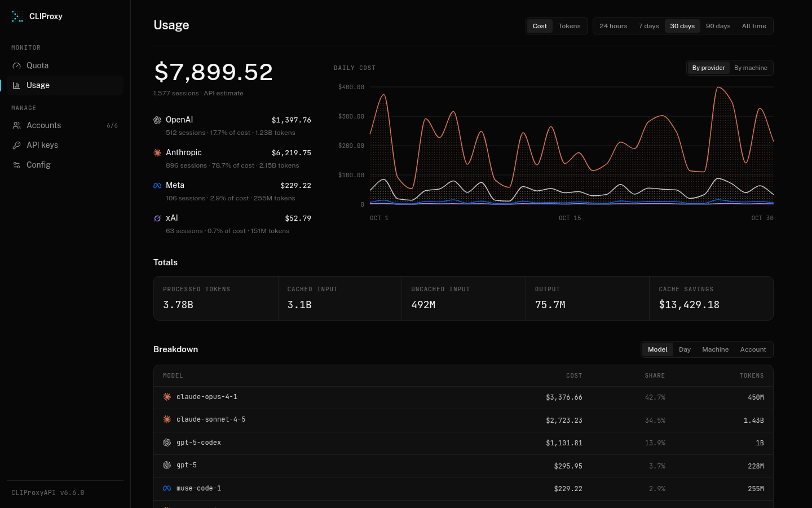

# cliproxy-dashboard

A lightweight usage and cost dashboard for [CLIProxyAPI](https://github.com/router-for-me/CLIProxyAPI). It subscribes to CLIProxyAPI's usage stream, stores per-request token and API-equivalent cost history in SQLite, serves a T3 Code–style usage view, and exposes a JSON API for querying usage statistics.



## What it does

- **Usage & cost tracking**: Total spend and tokens by provider, model, day/hour, machine, and upstream account, priced from LiteLLM's public price table (with cache-read savings).
- **JSON API**: Query computed usage summaries directly via `GET /api/usage?range=24h|7d|30d|90d|all&tz=<IANA timezone>` and collector status via `GET /api/health`.
- **Single Bun process**: One Hono server collects CLIProxyAPI usage records into SQLite and serves both the API and the built React UI. No proxy management or config writes are exposed.

## Requirements

- CLIProxyAPI **v7.1.18 or later** (first release with usage Pub/Sub). Tested against v8.0.36.
- Remote management enabled on the proxy with a `secret-key` (used only to authenticate the usage Pub/Sub subscription).
- Usage statistics enabled on the proxy (see below).
- [Bun](https://bun.sh) 1.4+ and Node 22.12+ (for the build), or Docker.

## Quick start

On the machine running CLIProxyAPI:

1. Enable usage records in the proxy's `config.yaml` and restart or let it hot-reload:

   ```yaml
   observability:
     usage:
       usage-statistics-enabled: true
       redis-usage-queue-retention-seconds: 3600
   ```

   On pre-v8 configs the same keys sit at the top level.

2. Configure, build, and run:

   ```sh
   cp .env.example .env.local      # set CPA_MANAGEMENT_KEY, and CPA_TARGET if the proxy isn't on 127.0.0.1:8317
   npm ci
   npm run build
   bun server/src/index.ts
   ```

3. Open <http://127.0.0.1:5174>.

The server logs `[collector] subscribed to CLIProxyAPI usage` once it is receiving records. `GET /api/health` shows the same.

## API

| Endpoint | Purpose |
| -------- | ------- |
| `GET /api/usage?range=30d&tz=UTC` | Aggregated cost, tokens, time series, and breakdowns by provider, model, machine, and account (`range`: `24h`, `7d`, `30d`, `90d`, `all`) |
| `GET /api/health` | Collector connection status, price table timestamp, and Tailscale sync status |
| `GET /api/devices` | Known client keys/IPs with resolved machine names and totals |
| `PUT /api/devices/name` | Assign a custom machine name to a `key` or `ip` identity |
| `DELETE /api/devices/name` | Clear a custom machine name |
| `POST /api/import` | Import historical Claude Code / Codex usage transcripts prior to live collection |

## Configuration

All configuration is environment variables, read from `.env.local` in the working directory (Bun loads it automatically) or the process environment. See [`.env.example`](.env.example).

| Variable | Default | Purpose |
| -------- | ------- | ------- |
| `CPA_MANAGEMENT_KEY` | required | Plaintext management key (used only to subscribe to the usage queue) |
| `CPA_TARGET` | `http://127.0.0.1:8317` | CLIProxyAPI base URL |
| `USAGE_SERVER_HOST` | `127.0.0.1` | Server listen address |
| `USAGE_SERVER_PORT` | `5174` | Server listen port |
| `TAILSCALE_BIN` | auto | Path to the `tailscale` CLI, used to name machines by their tailnet name |
| `USAGE_DB_PATH` | `data/usage.db` | SQLite database |
| `PRICE_CACHE_PATH` | `data/litellm-prices.json` | Cached LiteLLM price table |
| `DASHBOARD_DIST` | `dist` | Built frontend to serve |

## Deploy

### Bun, as a service

Run `bun server/src/index.ts` from the repo directory under systemd, launchd, or similar. Keep `data/` on persistent storage.

### Docker

```sh
docker build -t cliproxy-dashboard .
docker run -d --name cliproxy-dashboard --restart unless-stopped \
  --network host \
  --env-file .env.local \
  -v "$PWD/data:/app/data" \
  cliproxy-dashboard
```

### Tailscale

[`deploy/compose.yaml`](deploy/compose.yaml) runs the dashboard next to a Tailscale sidecar that serves it over HTTPS on your tailnet ([`deploy/serve.json`](deploy/serve.json)).

## Security

- **The dashboard has no login.** Anyone who can reach it can read usage and device data, rename machines (`PUT`/`DELETE /api/devices/name`), and import historical transcripts (`POST /api/import`). It binds to `127.0.0.1` by default; to reach it from elsewhere, use an SSH tunnel, `tailscale serve` with Tailnet ACLs, or a reverse proxy with its own authentication. Do not expose it directly to an untrusted network.
- `CPA_MANAGEMENT_KEY` stays server-side and is used only to authenticate the usage Pub/Sub subscription; no CLIProxyAPI management endpoints are proxied.

## Limitations

- **Single consumer of usage records.** CLIProxyAPI deletes a usage record once it is read, so this server must be the only consumer reading the usage queue. Records produced while the server is down are kept for at most `redis-usage-queue-retention-seconds` (max 3600).
- Costs are API-equivalent estimates from LiteLLM's public list prices, not actual subscription billing. Models missing from LiteLLM's table show as unpriced unless overridden in the `price_overrides` table.

## Development

```sh
npm ci
npm run server        # Usage API and collector on 127.0.0.1:5174
npm run dev           # Vite on 127.0.0.1:5173, proxying /api to the server
```

| Command | Does |
| ------- | ---- |
| `npm run lint` | oxlint |
| `npm run server:check` | Type-check the server |
| `npm run build` | Type-check and build the frontend into `dist/` |
| `bun test` | Tests |
| `npm run db:generate` | Generate a migration after editing `server/src/db/schema.ts` |

### Importing earlier history

Claude Code and Codex transcripts from before the dashboard started collecting can be imported, so usage charts don't start empty:

```sh
bun server/src/import/local.ts                         # this machine's ~/.claude and ~/.codex
bun server/src/import/file.ts export.json --ip <ip>    # an export made on another machine
```

`export.json` has the shape `{ "files": [{ "tool": "claude-code" | "codex", "lines": ["<raw jsonl line>", ...] }] }`.

Both are safe to re-run; only history from before live collection began is imported.

## License

[MIT](LICENSE)
